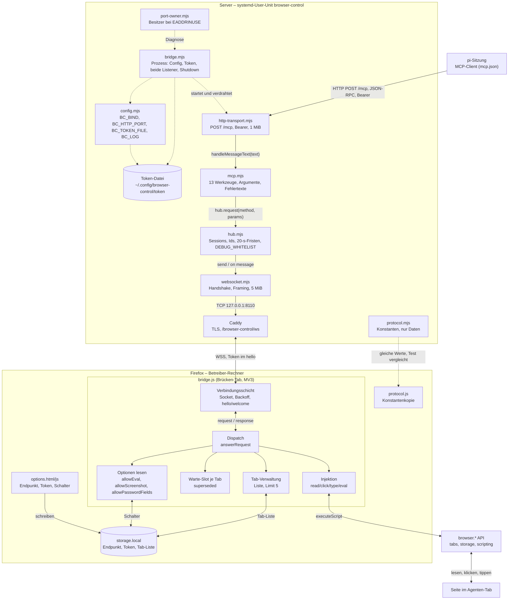
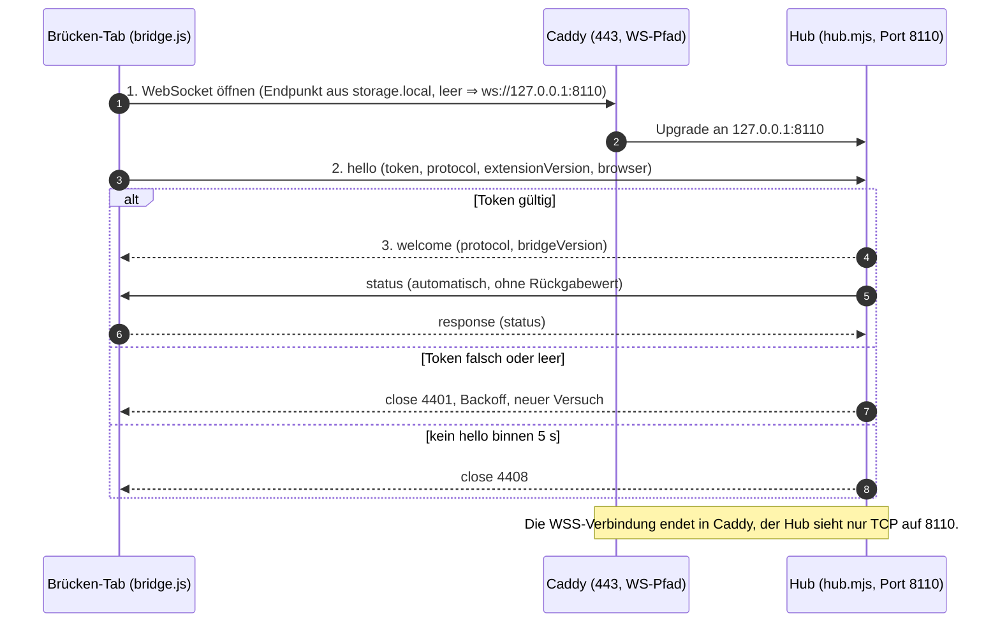
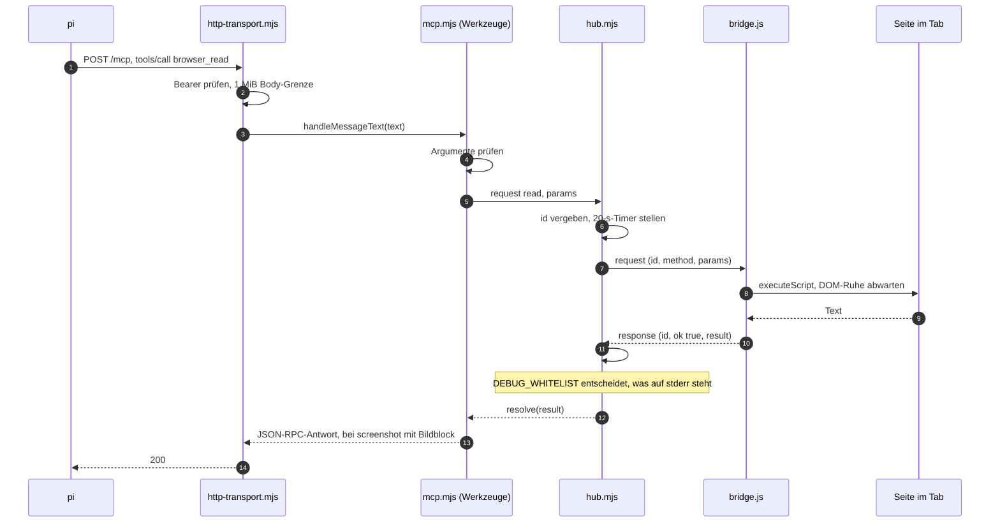

# Projektstand — browser-control

Der Zustand des Projekts, für einen Kontext, der neu anfängt. Diese Datei wird in
jedem Inkrement-Commit mitgezogen (siehe `CONTRIBUTING.md`, Schritt 7). Wenn sie einem
Log oder einer Spec widerspricht, gilt der Beleg und diese Datei ist falsch.

## Wo was steht (2026-11-12)

**Eine Übergabe-Datei gibt es nicht mehr.** Bis 2026-11-12 lag hier `docs/HANDOVER.md` (Stand, Entscheidungen, Betrieb); für die Veröffentlichung ist sie entfallen, weil sie Betriebsdaten trug. Der Stand steht in dieser Datei, das Verfahren in `CONTRIBUTING.md`, die Einrichtung in `INSTALL.md`.

## Stand (2026-11-22): alles, was der Agent liest, ist englisch (`docs/54`)

**Die Werkzeugbeschreibungen und alle Meldungen sind englisch — gebaut, die
Spec-Review steht noch aus.** Übersetzt sind die Refusals der Bridge
(`bridge-rs/src/mcp/texts.rs`, 51 Texte), die 13 Argument-Refusals und die 14
Werkzeugbeschreibungen (`tools.rs`), die Meldungen der Extension
(`extension/bridge.js`) und die gepinnten Sätze in `mcp.rs` bzw.
`test/extension.test.js`.
Fehlercodes (`eval_not_allowed`, `page_not_readable`, …) sind unverändert; die
Logzeilen `bc: …`, die Kommentare und die Dokumentation bleiben deutsch.

- **Die Spec-Messung war zu klein:** sie zählte Umlaute per `grep` und übersah
  damit die Argument-Refusals in `tools.rs`, die Werkzeugbeschreibungen (seit
  `c15f8b9` laut Spec englisch — waren sie nicht, `docs/53` hatte nur die
  `browser_help`-Anleitungen gebaut) und jede Meldung ohne Umlaut.
- **Neu: `bridge-rs/tests/texts.rs`** (`texts_shouldContainNoGermanUmlauts`) prüft
  `texts.rs`, `tools.rs` und `help.rs` zeilenweise, Kommentarzeilen ausgenommen. Er fängt
  vergessene Zeilen, die niemand pinnt — nicht aber einen deutschen Satz ohne
  Umlaut; dafür sind die gepinnten Assertions da.
- **Fixtures amendiert** (Freigabe des Betreibers): `1-initialize-and-tools-list.txt`
  trägt jetzt die englischen Beschreibungen, `2-tools.txt` und
  `3-extension-failures.txt` die englischen Sätze.
- **Beweise:** `cargo test` 305 Fälle grün (134 in `mcp.rs`), `clippy -D warnings`
  auf `x86_64-unknown-linux-musl` und `x86_64-pc-windows-gnu`, `npm test` 584,
  `npm run test:coverage` 92,2 % Zeilen (7 604 / 8 250),
  `npm run test:coverage:rust` 92,92 % Zeilen (3 658, 259 nicht gedeckt)
  Fälle, `npm run check` 0, `parity.sh --impl rust --check` 7/7, `--self-test` 7/7.
- **Review Runde 1 (2026-11-22):** `🔧 Fix these and I'll sign off`; alle Befunde
  eingearbeitet. `docs/53` und `CONTRIBUTING.md` sind nachgezogen. Ein deutscher
  Satzteil war durchgerutscht (`(entries: keine)` in `bridge.js`) und heißt jetzt
  `none`; ein neuer Node-Fall pinnt den Satz. Drei Review-Runden; die dritte
  blockierte an den alten Zitaten in weiteren Specs und wurde nach der
  Projektregel geteilt. `docs/55-alte-zitate-in-specs.md` ist seit 2026-11-22
  `active`: 73 Inventarzeilen, 38 Vertragsstellen nachgezogen, 21 Belege
  markiert, 14 Ausschlüsse.
- **Release `0.7.0` (2026-11-22):** Tag gebaut, XPI signiert (AMO `unlisted`),
  Firefox nimmt sie an (`signedState 2`, 129 687 Bytes), Release und beide
  portablen Zips tragen das signierte XPI. `docs/54` steht weiter auf `proposed`, bis die nächste Runde zustimmt.

## Stand (2026-11-18): `ws://` nur für Loopback, sonst `wss://` oder SSH-Tunnel

**Ein unverschlüsselter Dial ins Netz ist keine Verbindung, sondern eine
Fehlkonfiguration.** Vor dem Dial prüft die Brückenseite den Endpunkt: `ws:` auf
`127.0.0.1`, `[::1]` oder `localhost` wird verbunden wie bisher; `ws:` auf jedem
anderen Host wird **verweigert** — kein Socket, kein Reconnect, genau eine
Zeile `bc: ws:// ist nur für 127.0.0.1 erlaubt — für andere Rechner wss://
verwenden oder einen SSH-Tunnel auf 127.0.0.1 legen`. Der Endpunkt selbst steht
nicht in der Zeile (er kann Zugangsdaten im Hostnamen tragen). `wss://` bleibt
überall erlaubt, auch auf Loopback; ein Pfad ändert nichts, das Schema am Host
entscheidet (`isUnencryptedRemoteEndpoint` in `extension/bridge.js`).

- **Betreiberentscheid (2026-11-18):** ein TLS-Zertifikat für die Bridge auf
  einem anderen Rechner ist für viele Nutzer zu aufwendig. Der SSH-Tunnel ist
  die einfache Alternative (`INSTALL.md` §9, „No certificate? Tunnel it.“):
  `ssh -N -L 8110:127.0.0.1:8110 <user>@<server>` auf dem Browser-Rechner, dann
  weiter `ws://127.0.0.1:8110` eintragen — die Erweiterung sieht Loopback, SSH
  verschlüsselt den Rest.
- **Die CSP bleibt weit** (`connect-src 'self' ws: wss:`;
  `extension/manifest.json` unverändert): eine engere Policy würde bei einem
  `ws://`-Fehlversuch einen stummen `1015` erzeugen, statt unserer lesbaren
  Meldung (`docs/43`, Punkt 5).
- **Tests:** sechs neue Fälle in `test/extension.test.js`
  (`endpoint_wsOnLoopback_shouldConnect`, `endpoint_wsOnIpv6Loopback_shouldConnect`,
  `endpoint_wsOnLocalhost_shouldConnect`, `endpoint_wsOnAnotherHost_shouldRefuseAndLogOnce`,
  `endpoint_wssOnAnotherHost_shouldConnect`, `endpoint_wsWithPathOnLoopback_shouldConnect`).
  Die Optionsseite prüft die Regel bewusst nicht — sie würde nur das Speichern
  verweigern, und die Begründung gehört dorthin, wo der Nutzer sie liest.

## Stand (2026-11-18): Spec 43 (Manifest auf MV3) ist `active`

**Das Manifest ist MV3, die Werkzeuge antworten im echten Firefox.** `scripting`
statt `tabs.executeScript`, `host_permissions` statt `<all_urls>` in `permissions`,
`action` statt `browser_action`, Hintergrund als Eventpage ohne `persistent`,
`page-agent.js` als MV3-`web_accessible_resources`. Gemessen wurde am 2026-11-18
mit Firefox 152 (headless, web-ext) gegen einen eigenen Bridge-Prozess auf
18810/18811: `extension connected` nach 6,5 s, `browser_open_tab` ⇒ `tabId 3`,
`https://example.com/`, `browser_read` ⇒ 917 Zeichen `innerText`, kein
`not_readable`.

- **Ein Befund, der in keiner Spec stand:** mit der Vorgabe-CSP von MV3 kam
  **keine** Verbindung zustande. Firefox lädt `ws://` auf `wss://` hoch, der
  Socket schloss mit `1015` (TLS-Handshake), und weder Bridge noch Konsole sagten
  warum. Im Manifest steht deshalb
  `content_security_policy.extension_pages = "script-src 'self'; object-src
  'self'; connect-src 'self' ws: wss:"`; ein Manifest-Fall pinnt es
  (`manifest_shouldLetTheBridgePageDialAPlainWebSocket`).
- **Tests:** `test/manifest.test.js` trägt die vier MV3-Pins plus den CSP-Pin;
  `test/extension.test.js` stubbte die Injection auf `browser.scripting`
  (`injectFile`, `{target, files}`, ein `{frameId, result}` je Rahmen) und hat
  `action_namespace_shouldFollowTheManifestVersion`. 447 Fälle dort, 524 in
  `npm test`.
- **Offen beim Betreiber — Betreiberentscheid (2026-11-18):** die 8-h-Messung
  (Kriterium 7 von `docs/43`); dazu Kriterien 8 und 9 (Schlaf der Eventpage,
  Mitschnitt nach dem Schlaf) und Kriterium 6 (`permissions.contains` in der
  Konsole der Erweiterung). Die Handprobe belegt, dass Rechte und Injection
  greifen; sie belegt **nicht** acht Stunden.
- **Beweise:** Kriterium 1 ⇒ `3 false true true true false`; `grep -Fc
  'browser.tabs.executeScript('` in `bridge.js`/`background.js` ⇒ 0; `grep -Fc
  'browser.scripting.executeScript(' extension/bridge.js` ⇒ 1; `npm test` 524
  Fälle `# fail 0`; `npm run check` 0; Parität 7/7.

## Stand (2026-11-18): Spec 30 (Prozess und Konsole) ist `active`

**Der Windows-Betrieb, Teil 1b, ist gebaut — im Rust-Port.** Die Spec war am 2026-11-06
gegen die Node-Bridge geschrieben worden; deren Dateien sind mit `docs/38` gelöscht.
Deshalb wurde vor dem Bau jeder Ziel-Punkt und jedes Kriterium gegen den Rust-Stand
geprüft (`docs/30`, `## Prüfung gegen den Rust-Stand`). Gebaut wurden die zwei Dinge, die
wirklich fehlten:

- **`Strg+Untbr` beendet die Bridge** wie `Strg+C`: `ctrl_break` neben `ctrl_c`
  (`bridge-rs/src/main.rs:422`–`:423`), dieselbe Zeile `received SIGBREAK, shutting
  down`, derselbe Exit-0-Pfad. `docs/38` Stufe 3 hatte den Signal bewusst weggelassen, um
  zeichengleich zur Vorlage zu bleiben.
- **Das MCP über stdio schweigt in einer Konsole:** `main.rs:129` startet den Dienst nur
  bei `!stdio::stdin_is_a_console()` (`stdio.rs:186`, `std::io::IsTerminal`). Pipe,
  Socketpair und `/dev/null` — pi, Paritäts-Treiber, systemd — sind unverändert.

**Schon mit `docs/38` Stufe 3 erfüllt** und nur noch nachgeprüft: Portbesitzer auf
Windows (`GetExtendedTcpTable`), Startzeilen, Exit 1/2, die Besitzerzeile, der
Dienst-Ersatz (Task Scheduler). **Überholt** sind Kriterium 3 (die Node-Skip-Zählung) und
Kriterium 6 (die zwei `INSTALL.md`-Empfehlungszeilen, mit `docs/41` neu geschrieben).

**Offen beim Betreiber:** die Messung auf einem Windows-Rechner — `Strg+C`/`Strg+Untbr`
kommen an, stdout bleibt 0 Byte, `tools/list` antwortet (`INSTALL.md` § 10). Der Windows-Bau
ist kompiliert und lint-frei, nicht gelaufen. **Belege:** Parität 7/7, `cargo test` 283
Fälle 0 failed, `npm test` 522 Fälle `# fail 0`, `npm run check` 0.

## Stand (2026-11-18): Spec 28 (Log-Hygiene) ist `active`

**Die Whitelist für den Debug-Block ist abgeschlossen** — Code seit 2026-10-30
(alle vier Stufen, beide Code-Reviews `✅`), jetzt auch Amendments, Lückenprüfung
und Live-Messung. Im Rust-Port heißt die Tabelle `DEBUG_WHITELIST`
(`bridge-rs/src/hub.rs`), die Projektion `project`, der Eintritt
`debug_block_of`; die Node-Fassung `bridge/hub.mjs` ist mit `docs/38` gelöscht.

- **Die Amendments sind nachgezogen** in `docs/05` (Hub-Absatz, `## Bekannte
  Lücken`, `#logDebugResult`), `docs/08` (Hub und Testing-Zeile), `docs/09`
  (Inspect-Block, Dev-Plan-Stufe 3) und `docs/07` (`title`-Falle): der
  Debug-Block ist eine Whitelist, `title` erscheint dort als Länge.
- **Von fünf Lücken bleiben zwei** (`docs/28`, `## Bekannte Lücken`): ein
  Ergebnis, das kein Objekt ist, druckt weiter JSON im Klartext (gepinnt, nicht
  zugesagt), und `title` als Länge ist in `click`/`type` nicht gepinnt. Der
  Tabellen-Tippfehler, das flache `Object.freeze` und `__proto__` sind mit dem
  Port entfallen — `__proto__` ist in Rust ein gewöhnlicher Schlüssel und trägt
  den Marker (am 2026-11-18 gemessen).
- **Live gemessen am 2026-11-18, ohne Browser:** gegen einen zweiten eigenen
  Prozess (Ports 18810/18811, `BC_LOG=debug`) mit einer nachgebauten Extension
  zeigt der `read`-Block `"text": "<19 chars>"`, `"title": "<14 chars>"` und
  für ein erfundenes Feld `"<unlisted field>"`; `grep -c GEHEIMER-SEITENTEXT` im
  stderr ⇒ 0. Die zwei Treffer auf `GEHEIMER-TITEL` sind die `status`-Blöcke, in
  denen `title` absichtlich voll steht (Byte-Pin in `bridge-rs/tests/hub.rs`,
  `hub_withDebugLogging_shouldLogTheStatusLineAndTheIndentedResult`, und
  Paritätsvergleich 7) — offen als Folgeinkrement.
- **Weiter beim Betreiber:** der Haken an Kriterium 5 für den echten Firefox
  (`browser_read`/`browser_inspect` an einer echten Seite).

**Nicht mehr offen** ist damit der Grund, aus dem `docs/28` als einzige Spec mit
fertigem Code `proposed` stand (`docs/ROADMAP.md`, Zeile 18 ⇒ erledigt).

## Stand (2026-11-18): der Schalter in der Symbolleiste

**`docs/44` ist `proposed`, Stufen 1–4 sind gebaut** (nicht committet). Die
Erweiterung hat ein Symbol in der Symbolleiste und ist nach der Installation
**aus**: kein Tab, kein Socket. Ein Klick schaltet an (Tab, Socket), ein Klick
schaltet aus — und sagt vorher Servus.

- **Drei Zustände, drei Icons:** `icons/bridge-off.svg` (überkreuzt, Vorgabe),
  `icons/bridge.svg` (verbunden), `icons/bridge-offline.svg` (gelber Blitz: an,
  aber die Bridge antwortet nicht). Gezeichnet auf 32 × 32 mit `context-fill`,
  damit sie in beiden Themes lesbar bleiben. `default_icon` im Manifest ist das
  `off`-Icon; die anderen zwei setzt `setIcon` zur Laufzeit.
- **Der Zustand ist `bridgeEnabled` in `storage.local`**, Vorgabe `false` (kein
  Wert ⇒ aus). Die Zeile `const DEFAULT_BRIDGE_ENABLED = false;` steht in
  `bridge.js` **und** `background.js` — der Koordinator entscheidet über den Tab,
  bevor es eine Seite gibt, die Seite entscheidet über den Socket. Der dritte
  E2E-Seam patcht beide Dateien und zählt **je Datei 1** (`state=1`).
- **Der Klick lebt im Koordinator**, der Namespace hängt an der
  `manifest_version` (`browserAction` unter MV2, `action` unter MV3); ein Fall
  fährt beide Richtungen. Seit `docs/43` ist `action` der laufende Zweig. `extension.test.js` und `test/bridge-tab.test.js`
  brauchten dafür `storage.local`, `runtime.sendMessage`, `runtime.onMessage`
  und den Action-Stub.
- **Ausschalten in der Reihenfolge:** `goodbye` auf die Leitung, `close(1000)`,
  Tab zu, dann `bridgeEnabled = false`. Ohne offenen Socket entfällt `goodbye`.
  `onSocketClosed` verbindet bei `aus` nicht weiter (und ein Klick bricht den
  laufenden Reconnect-Timer ab).
- **`GOODBYE` steht in beiden Protokolldateien** (`extension/protocol.js`,
  `bridge-rs/src/protocol.rs`); die Bridge tut nichts damit (`hub.rs` verwirft
  unbekannte Typen). Beim Bauen fiel auf, dass
  `protocol_constants_matchTheExtension` **schon vorher rot war**: `docs/45` hatte
  `INJECTION_REPLY_TIMEOUT_MS` einseitig angelegt. Die Kopie ist nachgetragen.
- **`docs/42`, Kriterien 13/14 sind mitgebaut:** der Brücken-Tab erscheint nicht
  in `browser_status` und ist für jedes Werkzeug `no_agent_tab` — auch wenn seine
  Id in `agentTabIds` steht.
- **Ungemessen:** Kriterien 5–8 aus `docs/44` (echter Klick, Blitz binnen 5 s,
  `off` überlebt den Neustart, 60 s ohne `extension connected`) brauchen einen
  Browser und den Betreiber. Ebenso ungemessen: ob die drei SVGs bei 16 px
  lesbar sind.

## Stand (2026-11-18): die Injection-Naht ist auf dem Produktionspfad fertig

**`docs/45` ist `proposed`, Stufe 1 ist vollständig gebaut** (1a und beide Blöcke
von 1b). Alle 16 Aufrufer laden `extension/page-agent.js` als Datei und fragen
`{callId, op, args}` über `tabs.sendMessage`; die Seite antwortet mit
`{callId, ok, value}`. Es gibt **keinen Quelltext-Pfad** mehr: `pageSnippetCode`,
`PAGE_HELPERS_CODE` und der Testhaken `globalThis.__bcInjectionProbe` sind
gelöscht, `injectPageCode` heißt `askPageAgent` und kennt nur noch den
Nachrichtenpfad. Kein Werkzeugergebnis, kein Fehlercode und kein deutscher Satz
hat sich geändert (508 Node-Fälle grün, Parität 7/7).

- **Die Seitenfunktionen leben in `page-agent.js`:** `read`, `settle`, `click`,
  `type`, `inventory`, `inspect` (mit der `>>>`-Verzweigung), `eval` und die vier
  Transcript-Ops. Welche `inspect`-Variante läuft, entscheidet die Seite — die
  Frage nach einem `>>>` ist eine über das DOM, nicht über den Transport.
- **`frames` kommt aus Selbstmeldungen:** ein `inventory`-Aufruf an den ganzen
  Tab, jede Antwort trägt `sender.frameId`, `framesOf` filtert die Adressen. Die
  Sammlung endet erst bei der Frame-Zahl (oder an ihrer 5 000-ms-Frist); späte
  Antworten fallen über `callId` weg.
- **Harness:** `createPageAgentChannel` fährt die Ops im Seitenrealm der Fixture
  (`pageContextOf`) und sammelt die Antworten über den Kanal; `answer` stellt
  eine Antwort pro Op (`{silent: true}` für einen stummen Op, `{error}` für einen,
  der wirft), `refuseInjection`/`refuseInjectionTimes`/`refuseInjectionAfter`
  bilden die drei Wege ab, auf denen Firefox die Datei verweigert.
  `advanceMs: null` heißt „Uhr leerlaufen lassen“, eine Zahl hält sie an einem
  benannten Zeitpunkt an. Die vier `injection_*`-Fälle laufen ohne Haken über
  `inspect`.
- **Eine Semantik, die die Naht mitbringt:** ein Aufruf, den sein eigener
  Watchdog beendet (der `eval`-Guard bei 2 500 ms), lässt die Sammel-Frist von
  5 000 ms stehen; sie räumt sich selbst ab und die späte Antwort wird verworfen.
  Der Fall, der das berührt, sagt das jetzt ausdrücklich.
- **Ungemessen:** die Messung am echten Browser (Kriterien 6 und 7 aus `docs/45`)
  steht aus. Das ist Stufe 3 und der nächste Schritt.

## Stand (2026-11-17): die CI prüft, was ausgeliefert wird

**`docs/40` ist `active`.** `.github/workflows/test.yml` hat fünf Jobs in einer
Datei: `test` (unverändert: Syntax und `npm test` auf Node 22 und 24, ohne Rust),
`unit`, `e2e`, `bundle` und `release`. Der Befund, der dazu führte, bleibt richtig:
vorher lief nur `npm run check` und `npm test` — der grüne Haken sagte nichts über
die Bridge.

- **`unit`** baut beide Ziele mit `--release`, also die Binaries, die auch
  ausgeliefert werden; `scripts/parity.sh` und `scripts/bundle.sh` suchen genau
  dort. Danach `npm run check`, `npm test`, `npm run test:ci`,
  `cargo test -- --test-threads=1` (echte Bridges binden Ports), `clippy -D
  warnings --all-targets` für beide Ziele, `parity.sh --check` (7/7) und
  `--self-test` (7/7 rot). Ergebnis: die Artefakte `bridge-linux` und
  `bridge-windows`.
- **`e2e`** läuft auf `windows-latest`, lädt `bridge-windows` in den
  Cargo-Pfad zurück und führt `node scripts/e2e/run.mjs` aus: Firefox startet
  headless, `web-ext@8.9.0` installiert die Erweiterung als **temporäres**
  Add-on, über `POST /mcp` wird `browser_open_tab` auf eine Beacon-Seite
  gerufen, und **die Seite selbst** meldet sich mit `fetch("/ping")`. Der Beacon
  ist der Beweis: die Bridge könnte „ok" antworten, die geladene Seite nicht.
- **`bundle`** holt beide Binaries, baut die zwei Zips (`docs/39`), prüft sie mit
  `npm run test:bundle` und lädt `portable-zips` hoch. **`release`** steht in
  derselben Datei (`needs`/`download-artifact` gelten nicht über Dateigrenzen),
  läuft nur bei Tag `v*`, hat `permissions: contents: write` und hängt beide Zips
  an das Release.
- **Lokal:** `bash scripts/ci-local.sh` fährt `unit` und `bundle` in derselben
  Reihenfolge (Builds → Tests → `parity` → `bundle.sh` **vor** `test:bundle`,
  weil die Fälle die Zips lesen) und endet mit `ci-local: alle Schritte grün`.
  `node scripts/e2e/run.mjs` ist der Blackbox-Ablauf, `--only-bridge` seine erste
  Hälfte ohne Firefox. Alles, was das Skript anlegt, liegt unter `os.tmpdir()`.
- **Der Seam** ist ein Textpatch auf zwei Zeilen in einer **Kopie** von
  `extension/` (Endpunkt → `ws://127.0.0.1:18810`, Token als Rückfall in
  `readSettings`), beide mit `grep -Fc` gezählt. `options.js` trägt denselben
  Endpunkt-Anker und wird deshalb weder gepatcht noch gezählt. `--self-check`
  prüft nur die zwei Anker; `test/ci/e2e.test.js` pinnt beide Richtungen
  (`ok` und `seam moved`).
- **Ports:** 18810/18811/18990 — außerhalb der 8110/8111 des Dienstes und der
  18110–18119 der Test-Suiten. Aufgeräumt wird **per PID** (POSIX als
  Prozessgruppe, Firefox über die PID seines Wrappers, Windows mit
  `taskkill /T`), nie per Muster.

**Gemessen (2026-11-17, Linux, Firefox 152, Release-Binary):** `run.mjs` ⇒ Exit 0,
`extension connected` nach dem Start, `open tab=2`, `PING 2026-11-17T16:07:19.390Z`;
`E2E_BEACON_MODE=broken` ⇒ Exit 1 ohne PING, obwohl die Bridge `open tab=2` meldet;
`--only-bridge` ⇒ Exit 0 ohne Browser; `npm run test:ci` ⇒ 11 Fälle, `# fail 0`;
`bash scripts/ci-local.sh` ⇒ Exit 0. **Nicht gemessen:** der `windows-latest`-Lauf
und damit der `.exe`-Weg im E2E — er ist der erste Lauf nach dem Push.

## Stand (2026-11-17): das portable Paket ist gebaut

**`docs/39` und `docs/41` sind `active`.** Ein Befehl baut zwei Zips
(`bash scripts/bundle.sh`), jedes mit **sieben Einträgen**: der Ordner-Eintrag,
das Binary, die XPI, das Startskript, `README.txt`, `FIREFOX.md`, `CLIENTS.md`.

- **Die Zips:** `dist/browser-control-0.4.0-linux-x86_64.zip` (Binary aus
  `bridge-rs/target/x86_64-unknown-linux-musl/release/`) und
  `…-windows-x86_64.zip` (`.exe` und `start.cmd`, CRLF). Startskript und Binary
  liegen mit `0755` im Archiv; die Version kommt aus `extension/manifest.json`,
  also aus einer Quelle.
- **Die Startskripte** (`deploy/portable/start.sh`, `start.cmd`) legen `data/` an
  und beim ersten Lauf `data/token` (64 Hex, `0600`), überschreiben ein
  vorhandenes Token nie, drucken genau drei Zeilen (`endpoint:`, `http:`,
  `token:`) und werden per `exec` das Binary mit `--http`. Kein `nohup`, keine
  PID-Datei; eine Wildcard-Adresse wird als `127.0.0.1` gedruckt.
- **Die Anleitungen** liegen in `docs/portable/` und gehen von dort ins Zip —
  eine Quelle, keine zweite Fassung. Englisch nach STE100, ohne Lint.
- **Tests:** `npm run test:bundle` sind **9 Fälle**
  (`test/bundle/bundle.test.js`), grün; `npm test` bleibt binary-frei und
  unverändert bei **492 Fällen**.

**Was nicht gemessen ist:** `start.cmd` und der `.exe`-Weg sind gebaut, nicht
gelaufen — Betreiber-Messung auf einem Windows-Rechner. Die Erweiterung bleibt
temporär: nach einem Firefox-Neustart ist sie weg, und die Anleitung sagt das.

## Stand (2026-11-17): der Schnitt ist vollzogen — die Bridge ist Rust

**Umgeschaltet und im Betrieb gemessen (2026-11-17, 14:52):** Der Dienst läuft
als `/home/adrian/.local/bin/browser-control-bridge --http` (systemd-User-Unit,
PID 3429820), bindet 8110 und 8111, die Extension verbindet sich mit
`protocol=1`, und die drei Werkzeugwege sind gegen den echten Firefox gelaufen:
`browser_status` (1 Fenster, 5 Tabs), `browser_open_tab` ⇒ Tab 8,
`browser_read` (300 Zeichen, `truncated=true via=innerText`),
`browser_close_tab` ⇒ `closed: true`, danach wieder 5 Tabs und kein
Agenten-Tab. Die Logzeilen stimmen mit der Node-Form überein
(`open tab=8 url=…`, `read tab=8 … chars=300 truncated=true via=innerText`,
`close tab=8`).

**`docs/37` und `docs/38` sind `active`; die Node-Bridge ist mit diesem Inkrement
gelöscht.** Ein Commit nimmt `bridge/` (acht Dateien), die zehn Node-Bridge-
Testdateien und `test/ports.js` aus dem Baum; danach gilt
`git log --diff-filter=D --oneline -- bridge/ | wc -l` ⇒ **1**.

| Was | Stand |
|---|---|
| Betrieb | `browser-control-bridge`, ein statisch gelinktes Rust-Binary (`bridge-rs/`), gestartet von `deploy/browser-control.service` (`ExecStart=%h/.local/bin/browser-control-bridge --http`) |
| Windows | derselbe Prozess als `.exe`, gestartet vom Task Scheduler (`deploy/windows/browser-control-bridge.xml`) — kompiliert, nicht gelaufen |
| Node | nur noch Werkzeug: `npm test`, `npm run check`, `scripts/parity.sh` |
| Node-Suite | **492 Fälle** grün (`# fail 0`, `# cancelled 0`, `# skipped 0`), vorher 765 — die 273 sind die zehn gelöschten Bridge-Testdateien |
| Rust-Suite | **283 Fälle**, 0 failed (`cargo test … -- --test-threads=1`) |
| Paritätsmaßstab | **7/7** (`scripts/parity.sh --impl rust --check`, Exit 0); `--self-test` **7/7 rot**; die sieben Artefakte in `scripts/parity/expected/` sind **eingefroren** — `--record`, `--impl node` und `node,node` antworten mit Exit 1 |
| Syntaxprüfung | `npm run check` ⇒ `checked 14 files`, Exit 0 (vorher 33) |

**Was das für den Betrieb heißt:** der Betreiber schaltet um, nicht das Repo. Der
laufende Dienst startet bis zu seinem nächsten Neustart weiter den alten
Node-Code; danach läuft er nur noch, wenn das Binary gebaut und mit
`./scripts/install.sh` installiert ist (`INSTALL.md`, Abschnitt 3). Die
Umschaltung selbst ist `systemctl --user stop browser-control`,
`cargo build --release --target x86_64-unknown-linux-musl`,
`./scripts/install.sh`, `systemctl --user start browser-control`.

**Die Abschnitte „Wie ein Aufruf läuft" weiter unten nennen die Node-Dateien**
(`bridge.mjs`, `hub.mjs`, `mcp.mjs`, …). Sie sind der Stand bis zum Schnitt und
bleiben als Beschreibung des Flusses richtig — die Dateinamen haben Rust-
Entsprechungen in `bridge-rs/src/` (`main.rs`, `hub.rs`, `mcp/`, `http.rs`,
`ws/`, `platform/`). Wer den Code heute liest, liest dort.

## Stand (2026-11-12, nachts): Teil 2 ist abgenommen

**`docs/33-spurwahl.md` und `docs/34-spurendatei-beobachten.md` sind `active`.**
`browser_transcript` liest die Sprache des Transkripts aus der **Spurendatei**
(`api/timedtext`), deren signierte Adresse die Extension selbst mitschneidet
(`browser.webRequest`, neue Berechtigung 2026-11-12).

**Beide Live-Kriterien sind am 2026-11-12 grün gemessen:**

| Video | Ergebnis |
|---|---|
| `v=<video-en>` (Original Englisch) | englische Segmente, `requestedLanguage`/`deliveredLanguage` = `en`, 18 430 Zeichen |
| `v=<video-ja-2>` (Original Japanisch) | japanische Segmente („皆さんこんにちは！…"), `ja`/`ja` |

**Was der Weg tut:** Modell lesen → Zielspur nach der Betreiberregel bestimmen
(en/de, sonst englische Spur, sonst Original) → bei Bedarf im Player-Menü
setzen (Anker über den Modellnamen, `>>`-Suffix wird abgeschnitten) → einmal
springen, damit der Player die Datei holt → Adresse aus dem Mitschnitt →
JSON3 mit Zeitstempeln lesen → **Spur und Abspielposition zurückstellen**.
Die Adresse bleibt in der Extension: nicht in der Antwort, nicht im Log.

**Drei live gemessene Löcher wurden dabei geschlossen** (alle im Menü-/
Spurweg, nicht im Mitschnitt): fehlender `defaultCaptionTrackIndex` (ein
Track ⇒ Original; mehrere einer Sprache ⇒ manuell vor ASR), `>>`-Suffix am
Menüeintrag, und der Paar-Eintrag in der Gegenprobe der Menüzahl.

**Teststand:** 764 Tests grün, `npm run check` 0 (33 Dateien).

**Rust-Port (seit 2026-11-16):** `docs/37` (Teil 1) ist `active` und **gebaut** —
die Toolchain steht (rustc 1.100.0, clippy, mingw GCC 13), `bridge-rs/` baut
statisch für `x86_64-unknown-linux-musl` (542 KB) und `x86_64-pc-windows-gnu`
(`PE32+`, 1,2 MB), und `scripts/parity.sh` misst gegen **sieben eingecheckte
Soll-Artefakte** (`--check` 7/7, `node,node` identisch, `--self-test` 7/7 rot).
`docs/38` (Teil 2, der Port) ist `proposed`; seine Runde-1-Befunde sind
eingearbeitet, gebaut ist dort noch nichts. — **Überholt:** Teil 2 ist seit
2026-11-17 gebaut und abgenommen, die Node-Bridge ist gelöscht (Abschnitt oben).

**Seit 2026-11-15 veröffentlicht:** `v0.1.0` (erste Quellenmarke), `v0.2.0`
(`scripts/install.sh`), `v0.3.0` (Standard-Endpunkt), `v0.4.0`.
Die Specs 35 und 36 sind `active`; `docs/28` ist die einzige Spec, deren
Code fertig ist, die aber noch `proposed` steht (Amendments und
Live-Messung fehlen). — **Überholt:** `docs/28` ist seit 2026-11-18 `active`
(Amendments nachgezogen, live gemessen; Abschnitt oben).

**Sprache der Optionsseite (2026-11-15):** die sichtbaren Texte der
Erweiterungs-Einstellungen sind **englisch** (Betreiberentscheid, das Projekt ist
öffentlich). Werkzeugfehler und Logzeilen bleiben deutsch.
**Überholt seit `docs/54` (2026-11-22):** deutsch bleiben nur die Logzeilen; die
Werkzeugbeschreibungen und alle Meldungen im Agentenpfad sind englisch.

**Was bleibt (dokumentiert, nicht behoben):** das Etikett einer YouTube-Spur
kann lügen (auf `wKv-g1uEoDY` ist die einzige Spur `ja` etikettiert und
enthält deutschen Text — Spracherkennung ist `## Non-goals`); die Gültigkeit
der signierten Adresse, Worker-Anfragen und Videos mit 0 Cues sind ungemessen.

## Stand (2026-11-12): Teil 2 neu geschnitten — Text aus der Spurendatei

**`docs/33-spurwahl.md` (Teil 2) ist `proposed` und auf die Spurendatei
umgeschnitten; gebaut ist es nicht.** Der Live-Lauf (Kriterium 9) hat die erste
Fassung widerlegt: das Transkript-Panel **folgt der Untertitelspur nicht**.
Gemessen auf `v=<video-en>` mit sechs Eingriffen — Spur auf Englisch, auf die
ASR-Spur, auf Thai, „Automatisch übersetzen → Englisch“, jeder mit einem
Neuladen der Seite. Das Panel lieferte in **allen** Fällen denselben deutschen
Text (`totalChars` 19 777).

**Die Ursache** (neu — und eine Korrektur an M6 aus `docs/33`): die
Transkript-`params` in `ytInitialData` tragen die Sprache. Der äußere
Base64-Blob enthält den URL-kodierten inneren Blob mit `(kind, language)`:
`("", "de")` beim englischen Video, `("asr", "ja")` beim japanischen. Die
Seite wählt also beim Laden „die Spur in der Oberflächensprache, wenn es eine
gibt, sonst die Standardspur“. Kein Menü erreicht diese Wahl. Der Gegenweg
über `get_transcript` bleibt zu (HTTP 400, auch mit den Original-`params`).

**Der neue Weg** (gemessen, nicht gebaut): der Player lädt die Untertitel als
`api/timedtext`-Anfrage; deren **signierte** Adresse steht in
`performance.getEntriesByType('resource')` und liefert mit `&fmt=json3` die
**ganze Spur mit Zeitstempeln** (286 Cues Englisch bis 1105 s, 413 Cues
Japanisch bis 1228 s). Die `baseUrl` aus dem Player-Response liefert **0
Bytes** — es fehlt die Signatur; nur die Adresse des Players trägt. Der
Overlay im Player (`.ytp-caption-segment`) ist auch lesbar, aber sprachlich
unzuverlässig.

**Entschieden am 2026-11-12 (Betreiber):** Teil 2 wird auf die Spurendatei
umgeschrieben; nach dem Lesen werden **vorherige Spur und Abspielposition
zurückgestellt**. Einzelheiten in `docs/33`, M12–M15 und `## Ziel`.

**Gebaut am 2026-11-12:** Stufen 1–4 sind umgesetzt und committet —
`9044b07` (Spurendatei statt Panel), `06cce2b` (Menü, Sprung, Zurückstellen),
`34d0b5f` (Bridge und Fixture). **720 Tests grün**, `npm run check` 0. Die
Kriterien 1–11 und 14 von `docs/33` sind lokal belegt.

**Damals live durchgefallen (inzwischen gelöst durch `docs/34`),
Kriterium 12:** der Aufruf auf
`v=<video-en>` endet mit „Die Spurendatei zur Sprache „en" wurde auf dieser
Seite nicht gefunden." Die Ursache steht als **M18** in `docs/33`: der
`performance`-Kanal, aus dem die signierte `api/timedtext`-Adresse kommen
sollte, zeigt sie **nicht** — und er ist blind für Anfragen der Seite
(Kontrollprobe mit einem eigenen ``). Die Messung M13 (Adresse sichtbar)
ließ sich nicht reproduzieren.

**Folge:** `docs/33` bleibt `proposed`; die Kernannahme ist zurück in
`## Open questions`. **Achtung, Ist-Zustand:** das Werkzeug liefert für den
Hauptfall jetzt einen Fehler (`no_address`), wo Teil 1 noch Text in der
Sprache der Oberfläche lieferte. Ob das so bleibt, ob ein benannter Rückfall
aufs Panel gebaut wird oder ob Teil 2 zurückgerollt wird, ist eine
Betreiberentscheidung (offen).

**Was das Werkzeug jetzt tut** (Ist-Zustand, noch nicht live gemessen): es
bestimmt die Zielspur aus dem Modell (Original über `audioTrackId`, dann die
Betreiberregel), setzt sie bei Bedarf im Player-Menü nach dem Namen aus dem
Modell, lässt den Player durch einen Sprung um ±1 s die signierte
`api/timedtext`-Adresse holen, liest die Spur als JSON3 mit Zeitstempeln und
stellt danach die vorherige Spur und die Abspielposition zurück. Es nennt
`requestedLanguage` (gewählt) und `deliveredLanguage` (aus der Adresse).

**Was bleibt:** `browser_transcript` liefert, was YouTube zeigt — bei deutscher
Oberfläche Deutsch, auch für englische Videos (bei einem japanischen Video ohne
deutsche Spur liefert es dagegen Japanisch). Für die Recherche brauchbar (das
Modell liest beide Sprachen), aber **nicht** die Originalspur — und das
Werkzeug sagt das auch nicht zu: es nennt keine Sprache. Die Grenze steht in
`docs/32`, `## Bekannte Lücken`; die offenen Fragen in `docs/33`.

**Nicht gemessen:** wie lange die signierte Adresse gilt, ob sie im
Hintergrund-Tab entsteht, was Videos mit 0 Cues liefern.

## Stand (2026-11-11)

**Spec 31 (`docs/31-youtube-recherche.md`) ist `active` und abgenommen** — die
Recherche zu Roadmap-Zeile 17 (YouTube). Sie ist eine **Recherche-Spec**: kein
Produktcode, sondern Messung und Entscheidung. Zehn Messungen (M1–M10) wurden
am 2026-11-11 **live** im Firefox-Profil des Betreibers gefahren, nicht aus dem
Gedächtnis. Drei Review-Runden: Runde 1 `🔧` (6 Blocker), Runde 2 `🔧`
(2 Blocker), Runde 3 **`✅ Ship it`**.

**Der Kernbefund: das YouTube-Transkript ist heute schon mit den vorhandenen
Werkzeugen lesbar** — `navigate` → `focus` → `click` auf
`tp-yt-paper-button#expand` → `click` auf den Transkript-Knopf → `read`
liefert 30 966–31 011 Zeichen, davon 133 Segmente mit Zeitstempeln.

**Drei Befunde, die über YouTube hinausgehen** (in der Spec belegt, hier nur
benannt):

- **`browser_read` meldet `settled: true` auf einer Seite, die noch gar nicht
  geladen ist** (M6). Auf einer YouTube-Watch-Seite im Hintergrund-Tab stehen
  12 Zeichen, `settled: true`, nach 2 812 ms Wartezeit. Die Ruhe-Erkennung aus
  Spec 14/15 kann „lädt noch" nicht von „fertig" unterscheiden.
- **Die Caption-API von YouTube trägt nicht** (M4): `timedtext` antwortet HTTP
  200 mit **0 Bytes**, die innertube-Schnittstelle `get_transcript` mit HTTP 400
  `FAILED_PRECONDITION`. Das Transkript kommt aus der Oberfläche, nicht aus
  einer API.
- **Ein YouTube-Knopf hängt an der Oberflächensprache** (M10):
  `aria-label="Transkript anzeigen"` ist deutsch; stabil ist der
  Elementname `ytd-video-description-transcript-section-renderer`.

**Entschieden vom Betreiber (Q1–Q5):** ein neues Werkzeug
**`browser_transcript`**, mit der **Originalsprache** des Videos, **Text +
Zeitbezug**, **sprachunabhängig** über den Strukturanker; die
**Zusammenfassung macht das Modell des Agenten** — im Projekt kommt kein Code
dazu. **Kapitel und Bild sind ausdrücklich _nicht_ entschieden** (bewusst
offen, nicht abgelehnt). Die Folge-Spec ist benannt (Zuschnitt und
Kernannahme stehen in `docs/31`, unter `## Die Folge-Spec`) und liegt seit
2026-11-12 **in zwei Teilen** vor — siehe den Absatz unten.

**An den Arbeits-Tabs des Betreibers wurde nichts verändert:** die Messung lief
in Agenten-Tabs (dort wurde geklickt — das Aufklappen der Beschreibung und
der Transkript-Knopf), die danach **geschlossen** wurden; es ist kein
Agenten-Tab offen. Die Tabs des Betreibers selbst (Profil, Logins) blieben
unberührt.

**Die Folge-Spec liegt in zwei Teilen vor** — die gemeinsame Fassung wurde am
2026-11-12 nach dem **dritten Block** des Spec-Gates geteilt (`CONTRIBUTING.md`,
Schritt 4: „Nicht durchwinken"), mit der Naht „lesen" gegen „die richtige Spur
erzwingen":

- **`docs/32-transkript-werkzeug.md` (Teil 1, Lesen) ist `active` und gebaut:**
  das **dreizehnte** Werkzeug `browser_transcript` — Segmente mit Zeitstempeln
  aus dem angezeigten Panel, `offset`/`maxChars` wie `browser_read`, das
  Werkzeug öffnet das Panel selbst und wartet **eigen** auf Bereitschaft (kein
  `settled`), `#expand` wird nur geklickt wenn nötig, und ohne gerenderte Seite
  antwortet es `transcript_needs_focus` (der Agent ruft `browser_focus`).
  **687 Tests grün** (`# fail 0`, `# cancelled 0`, `# skipped 0`), Code-Review
  `✅` nach zwei Runden mit vier Mutationen. **Kriterium 9 steht aus** (live,
  Betreiber: Extension-Reload, dann ein Aufruf auf `v=<video-en>`).
- **`docs/33-spurwahl.md` (Teil 2, Spurwahl):** die Regel des Betreibers —
  Originalspur über den **Original-Audiotrack** (`audioTrackId` ohne
  `.3`-Suffix; der Index schwankt), bei nicht-englischem und nicht-deutschem
  Original die **englische Spur**, sonst das **Original mit genannter
  Sprache**; Spurwahl im Untertitel-Menü nach dem **Namen aus dem Modell**,
  danach Panel neu bauen.

**Die Kernannahme von Teil 2 ist ungeprüft:** das Transkript-Panel **folgt der
Untertitel-Wahl nicht** (es zeigte deutsch für ein englisches Video). Ob der
Neuaufbau des Panels die Spur wechselt, entscheidet erst das Live-Kriterium.
Ebenfalls gemessen: die **gelieferte Sprache ist im DOM nicht feststellbar** —
es gibt dort kein Sprachfeld.

Review-Stand der gemeinsamen Fassung: Runde 1 (`🔧`, 12 Blocker), Runde 2
(`🔧`, 8 Blocker), Runde 3 (`🔧`, 8 Blocker) — daraufhin geteilt. Die beiden
Teile gehen je **eigen** durch das Gate.

## Stand (2026-11-06)

**658 Tests grün** (`# fail 0`, `# cancelled 0`, `# skipped 0`). **Spec 29 ist
`active` und abgenommen**: `npm run check` prüft die Syntax mit
`scripts/check.mjs` statt mit `find`/`xargs`, meldet `checked 28 files` und läuft in
3,0–3,2 s. Damit ist die Abnahme aus `CONTRIBUTING.md` auf jedem Wirt tippbar, auf dem
Node läuft — der Windows-Lauf selbst ist Kriterium 2 von Spec 30.

**Spec 30 (`docs/30-prozess-und-konsole.md`) ist `proposed` und nicht begonnen:**
Prozess und Konsole auf Windows (`SIGBREAK`, stilles stdout im Terminal,
`portInUseLine`, Amendments an `docs/18`). Sie entstand am 2026-11-06 durch Teilung
einer dreifach geblockten Spec; die Blocker (N1, N2) sind dort eingearbeitet.
**Überholt 2026-11-18:** gebaut im Rust-Port, `docs/30` ist `active` (Abschnitt oben).

**Spec 28 (Log-Hygiene) ist weiterhin `proposed`** — Code fertig, beide
Code-Reviews `✅`, offen: Amendments in `docs/05`, `docs/07`, `docs/08`, `docs/09`,
die veralteten Verweise auf die gelöschten Redaktionshelfer und die Live-Messung.
**Überholt 2026-11-18:** alles davon ist erledigt, `docs/28` ist `active`
(Abschnitt oben); die veralteten Helfer-Verweise in `docs/06`, `docs/16`,
`docs/19` und `docs/20` stehen noch, sie liegen außerhalb der damaligen Boundary.

Offen im Betriebsteil: der Windows-Rechner für die Messungen aus Spec 30, und die
90-Sekunden-Frist der Abnahme (`test/mcp.test.js` lief am 2026-11-06 in 61,4 s von
90 — 1,47 ×, die Begründung in `CONTRIBUTING.md` rechnet mit 1,5 ×).
**Überholt 2026-11-18:** `test/mcp.test.js` ist mit der Node-Bridge gelöscht, die Frist
betrifft die Bridge nicht mehr; offen bleibt allein die Windows-Messung.

## Stand (2026-10-28)

**Zwölf Werkzeuge sind live**, `npm test` meldet 652 Fälle, `# fail 0`,
`# cancelled 0`. Gebaut und abgenommen sind die Specs 01–27 (`docs/README.md` trägt die Spalte
`Status`); die Frame-Reihe und Shadow DOM sind damit vollständig. **Spec 28
(Log-Hygiene) ist im Code fertig** — alle vier Stufen, beide Code-Reviews `✅` —
aber noch `proposed`: es fehlen die Amendments in `docs/05`, `docs/07`, `docs/08`,
`docs/09` und die veralteten Verweise auf die gelöschten Redaktionshelfer
(`docs/05:422`, `docs/06:297`, `docs/16:284`, `docs/19`, `docs/20:562`), dazu die
Live-Messung. — **Überholt 2026-11-18:** Amendments und Messung sind erledigt,
`docs/28` ist `active`; `docs/05:422` ist nachgezogen, die Fundstellen in
`docs/06`, `docs/16`, `docs/19` und `docs/20` stehen noch (außerhalb der
Boundary dieses Inkrements).

Was der Agent heute kann: navigieren, lesen (mit `offset`/`maxChars`, Artikelmodus),
klicken, tippen, fokussieren, inspizieren, Tabs öffnen/schließen, `eval` hinter
einem Schalter, Screenshots hinter einem Schalter, **Rahmen auflisten
(`browser_frames`), einen Rahmen lesen (`frame` bei `read`) sowie `inspect`/`eval`/`click`/`type`
auf einen Rahmen richten (`frame`)**.

Nicht gebaut: Shadow DOM (Roadmap 16), die Handlungswerkzeuge im Rahmen (25/26),
und alles im Sicherheits-/Betriebsteil (Roadmap 18, 23/24, 26–28).

Kriterium 6 von Spec 24 und Kriterium 4 von Spec 25 sind **noch nicht gemessen** (live, Betreiber): ob Firefox
mit `matchAboutBlank` in `about:blank`-Rahmen injiziert und wie die Ruhe-Erkennung
mit mehreren Rahmen läuft.

## Wie ein Aufruf läuft — Komponenten und Fluss (2026-11-06)

Ein Werkzeugaufruf von pi bis in die Seite hat sechs Stationen, und der Rückweg
läuft dieselbe Strecke. Was hier steht, ist aus dem Code gelesen (`bridge/*.mjs`,
`extension/bridge.js`, `extension/manifest.json`, `~/.pi/agent/mcp.json`) —
nicht aus den Specs. Die Bilder sind Mermaid: sie rendern auf GitHub und in jedem
Markdown-Betrachter mit Diagramm-Unterstützung, und wer nur Text sieht, liest die
Tabellen daneben. Widerspricht eine Spec dieser Darstellung, gilt der Code und die
Spec ist nachzuziehen.

### Der Komponentenplan

Wer existiert und wer mit wem spricht. Denselben Weg in zeitlicher Reihenfolge
zeigen die zwei Sequenzdiagramme darunter.

Die drei Schnittstellen, an denen etwas kaputtgehen kann:

| Kante | Vertrag | Grenze |
|---|---|---|
| pi ↔ `http-transport.mjs` | JSON-RPC 2.0 über `POST /mcp`, Bearer-Token | 1 MiB Body |
| `mcp.mjs` ↔ `hub.mjs` | `request(method, params)` als Promise im selben Prozess | 20 s Frist, `HubRequestError` |
| `Caddy` ↔ `bridge.js` | eigenes Textprotokoll, Version 1, `hello`/`welcome`/`request`/`response` | 5 MiB Nachricht, 5 s bis `hello` |

Wer was allein entscheidet:

- **`mcp.mjs`** — welche Argumente erlaubt sind und welcher Fehlercode zu welchem
  deutschen Satz wird. Kein zweites Werkzeugverzeichnis sonst irgendwo.
- **`hub.mjs`** — welche Sitzung die gültige ist und was auf stderr landet
  (`DEBUG_WHITELIST`). Nur dort, nicht in den elf `#report…`-Zweigen (gezählt:
  `git grep -nE '^  #report[A-Za-z]+\(' bridge/hub.mjs` ⇒ 12 Definitionen, eine davon
  `#reportResult`).
- **`bridge.js`** (seit `docs/42`; vorher `background.js`) — welche Tabs
  Agenten-Tabs sind (Liste in `storage.local`) und wer den Warte-Slot eines Tabs
  hält. Die Bridge weiß davon nichts.
- **`background.js`** — nur noch der Koordinator: legt den Brücken-Tab an
  (`bridge.html`, angepinnt, gemerktes Fenster) und legt ihn neu an, wenn er
  geschlossen, verworfen oder weg-navigiert wurde. Kein Socket, kein Backoff.
- **`protocol.mjs` / `protocol.js`** — die Zahlen und Typen des Drahtprotokolls,
  doppelt vorhanden, weil ein klassisches Erweiterungsskript kein ES-Modul
  importieren kann; `test/protocol.test.js` ist die Klammer.

Nicht im Plan: die Testdoppelung (`test/fixtures/fake-extension.mjs` ersetzt den
Brücken-Tab in den Tests) und das Dienstverhalten (`RestartPreventExitStatus=2`
für das fehlende Token, Exit 1 für einen belegten Port) — beides Betrieb, nicht
Komponente.

### Die Komponenten im Einzelnen

| Komponente | Datei / Ort | Rolle im Fluss |
|---|---|---|
| pi-Sitzung | MCP-Client, Eintrag `browser-control` in `~/.pi/agent/mcp.json` | ruft `browser_*` auf, Ziel `http://127.0.0.1:8111/mcp`, `Authorization: Bearer …` aus `~/.config/browser-control/token` |
| HTTP-Transport | `bridge/http-transport.mjs` | nimmt `POST /mcp`, prüft den Bearer-Token, **1 MiB** Body-Grenze, reicht den JSON-RPC-Text weiter; kennt keine Werkzeuge |
| MCP-/Werkzeugschicht | `bridge/mcp.mjs` | dreizehn Werkzeuge, Argumentprüfung, Fehlercode → deutscher Text, Bildblock bei `screenshot`; `handleMessageText` ist die **eine** Naht für stdio und HTTP |
| Hub | `bridge/hub.mjs` | `hello`/`welcome`, Token-Prüfung, Request-Ids, **20 s** Aufruffrist, Verdrängen der alten Verbindung, Logzeile + Debug-Block aus `DEBUG_WHITELIST` |
| WebSocket-Rahmen | `bridge/websocket.mjs` | Handshake und Framing ohne Abhängigkeit, **5 MiB** Nachrichtengrenze |
| Dienst | systemd-User-Unit `browser-control.service`, Start über `bridge/bridge.mjs` | besitzt den Prozess und beide Ports; `port-owner.mjs` nennt bei `EADDRINUSE` den Besitzer |
| Caddy | `wss://example.com/browser-control/ws` | TLS-Ende, Weiterleitung an `127.0.0.1:8110`; liegt **außerhalb** der Basic-Auth, weil ein Browser-WebSocket keinen `Authorization`-Header setzen kann |
| Brücken-Tab | `extension/bridge.html` + `extension/bridge.js` | hält den Socket (wählt sich **raus**, Reconnect mit Backoff), beantwortet Anfragen, hält den Warte-Slot **je Tab**, nutzt `tabs`/`executeScript`, sammelt den `webRequest`-Mitschnitt |
| Koordinator | `extension/background.js` (MV3-Eventpage, ohne `persistent`) | legt genau einen angepinnten Brücken-Tab an und hält ihn; kein Socket, kein Zustand über den Tab hinaus |
| Optionsseite | `extension/options.{html,js}` → `storage.local` | Endpunkt, Token, Schalter `allowPasswordFields` / `allowEval` / `allowScreenshot` (alle Default aus) |
| Die Seite selbst | Betreiber-Tab | dort läuft der injizierte Code (Lesen, Klicken, Tippen, `eval`) |

Zwei Kopien derselben Konstanten gehören dazu: `bridge/protocol.mjs` und
`extension/protocol.js`. Sie sind Daten, kein Verhalten — `test/protocol.test.js`
vergleicht beide über JSON. Im Test ersetzt `test/fixtures/fake-extension.mjs` die
echte Extension.

### Verbindungsaufbau: die Extension wählt sich raus

Kommt eine **zweite** gültige Extension-Verbindung, bekommt die alte `close 4409`
(`REPLACED`): es gibt genau eine authentifizierte Sitzung (`#current` im Hub).

### Ein Werkzeugaufruf, am Beispiel `browser_read`

Zwei Dinge, die man am Diagramm leicht falsch annimmt:

- **Der Warte-Slot für `click`/`type` sitzt nicht in der Bridge**, sondern in der
  Extension (`extension/bridge.js`, eine Kette je Tab). Ein neuer Aufruf im
  **selben** Tab beendet den älteren mit `superseded`; andere Tabs sind unberührt.
  Im Diagramm wäre das ein Pfeil innerhalb der Extension, nicht zwischen Bridge
  und Extension. Der Hub kennt keine Werkzeugsemantik — nur Anfrage-Ids, Fristen und
  die Logzeile je Methode samt `DEBUG_WHITELIST`.
- **`/mcp` geht nie über Caddy.** Der MCP-Pfad ist loopback-only
  (`127.0.0.1:8111`); nur der Extension-Pfad ist über den Proxy TLS-geschützt. Ein
  reiner `curl`-Client gegen `127.0.0.1:8111` funktioniert deshalb ohne Proxy —
  aber nur mit Token.

### Nachrichtenformen des Drahtprotokolls

| Richtung | Typ | Inhalt |
|---|---|---|
| Extension → Bridge | `hello` | `token`, `protocol`, `extensionVersion`, `browser {name, version}` |
| Bridge → Extension | `welcome` | `protocol`, `bridgeVersion` |
| Bridge → Extension | `request` | `id`, `method`, `params` |
| Extension → Bridge | `response` | `id`, `ok: true, result` **oder** `ok: false, error {code, message, …}` |

Die dreizehn Methoden: `status`, `navigate`, `read`, `click`, `type`, `focus`,
`inspect`, `open_tab`, `close_tab`, `eval`, `screenshot`, `frames`, `transcript`.
Antworten dürfen
**ungeordnet** kommen — der Hub hält eine `Map` offener Anfragen je Verbindung,
keine Warteschlange.

### Wo der Fluss endet

| Ausgang | Auslöser | Wirkung |
|---|---|---|
| `close 4401` | falsches oder leeres Token im `hello` | Logzeile `auth failed peer=…`, Socket zu, die Extension versucht es mit Backoff erneut |
| `close 4408` | kein `hello` binnen 5 s | Socket zu |
| `close 4409` | zweite gültige Verbindung | die **alte** wird verdrängt |
| `timeout` nach 20 s | keine Antwort auf eine Anfrage | `HubRequestError`, die Verbindung **bleibt** offen |
| `ok:false code=…` | die Extension lehnt ab (`page_busy`, `no_agent_tab`, `not_readable`, `eval_not_allowed`, …) | Logzeile `… failed … code=…`, die Verbindung bleibt offen |
| `unavailable` | keine Extension verbunden | Antwort ohne jeden Socket-Schreibvorgang |

## Stand (2026-10-27, nach Inkrement 01)

Inkrement 1 (Skelett) ist gebaut. `docs/01-skelett-verbindung-und-status.md`
(Stufen 1–7 abgeschlossen) liegt als `proposed` vor: Ziel, Abnahmekriterien und
Dev-Plan sind abgestimmt, das Spec-Review-Gate passierte in Runde 3 mit
`✅ Ship it`, das Code-Review-Gate in Runde 2.

Im Code:

| Teil | Dateien | Zustand |
|---|---|---|
| Bridge (Node ≥ 22, keine Abhängigkeiten) | `bridge/{protocol,websocket,config,bridge,hub}.mjs` | lauscht auf `BC_BIND`, prüft Token, fragt `status`, loggt auf stderr |
| Extension (Firefox MV3, Eventpage) | `extension/{manifest.json,protocol.js,background.js,bridge.html,bridge.js,options.html,options.js}` | der Brücken-Tab hält die Verbindung (WSS, Reconnect mit Backoff), der Hintergrund hält den Tab; Optionsseite für Endpunkt und Token |
| Prüfungen | `test/*.test.js`, `test/fixtures/fake-extension.mjs` | 587 Fälle, `npm test` grün (damals 243), ohne Browser und ohne Netz |

Caddy und Token-Datei sind eingerichtet, die Extension läuft als temporäre
Erweiterung im Profil des Betreibers, und pi startet die Bridge als
MCP-Kindprozess.

## Entschieden bei der Anlage

Diese Entscheidungen stammen aus der Anlage des Projekts und sind nicht neu zu
verhandeln; wenn eine davon falsch ist, gehört das in eine Spec mit
`## Open questions`, nicht in einen stillen Umbau.

1. **Firefox**, nicht Chromium: die Extension läuft im echten Profil des
   Betreibers, damit dessen Logins, Sessions und Passkeys gelten.
2. **Extension und Bridge sind ein Projekt** — die Browser-Seite und der
   MCP-Server auf dem Server werden zusammen spec-getrieben.
3. **Sichtbarer Tab in einem normalen Fenster** des Betreibers: der Agent
   navigiert im Hintergrund-Tab, `focus` holt ihn nach vorn.
4. **Default-Container**, keine Container-Isolation: ein Container hätte einen
   eigenen Cookie-Jar und wäre damit nicht eingeloggt.
5. **Transport: die Extension wählt sich raus** (WebSocket zum Server); kein
   Listener im Browser, kein SSH-Tunnel nötig.
6. **Die Bridge spricht MCP (stdio) für pi** — ein Eintrag in `mcp.json`.
7. **Anmeldung, Zwei-Faktor und Passkeys macht der Betreiber**; der Agent wartet
   auf den erreichten Zustand.

## Offen

- **Spec 23 (`browser_read` mit `mode: "article"`) ist `active` und gebaut**
  (2026-10-27): `read` kann jetzt den **Artikelkörper** liefern statt der ganzen
  Seite. Drei Auswahlstufen — semantische Wurzel (`article`, `main`,
  `[role="main"]`, `#content`, `#main`, erster Treffer ab 500 Zeichen), dann eine
  Dichte-Heuristik (Textmenge, Absätze, Linkdichte; ein Wrapper verliert gegen
  seinen inneren Block), dann der ehrliche Rückfall `root: null`,
  `fellBack: true`. Die gewählte Wurzel wird **auf einer Kopie** bereinigt (nav,
  header, footer, aside, form, script, style, noscript, iframe und die
  `cookie`/`consent`-Familien); eine leere Wurzel fällt zurück. `root` nennt den
  getroffenen Selektor, `mode: "text"` bleibt unverändert (nur ein Feld mehr).
  **559 Tests grün**, Abnahme grün, Spec-Review `✅` nach drei Runden (10 Blocker,
  6, 8 Zeilen), Code-Review `✅` nach zwei Runden — der Reviewer hat die
  Dichte-Stufe mit dem echten Schnipsel gemessen und dabei den Wrapper-Fehler
  gefunden (R2), der Umsetzer hat ihn rot-vor-grün behoben. **Kriterium 8 live gemessen** (2026-10-27, nach einer Nachbesserung): auf
  Wikipedia verschwinden „Impressum", „Über Wikipedia", „Haftungsausschluss" und
  „Cookie" (je 1× im Textmodus, 0× im Artikelmodus), der erste Satz ist enthalten,
  `root` ist `"main"` mit Abstieg in `#mw-content-text` (75 375 von 75 517); die
  Größenzusage hält auf der chrome-lastigen Seite (heise **52 %**). Die erste
  Messung war **rot** (102 %, „Datenschutz" 15×) — die Kernannahme war widerlegt,
  das Inkrement ging zurück in die Spec: Stufe 1 steigt jetzt ab, die Bereinigung
  kennt die Footer-Familie, Kriterium 8 ist geteilt. „Datenschutz" war
  **Artikelinhalt** (17×/15×) und wurde als Prüfstring ersetzt. Offene Zeilen unter
  `## Bekannte Lücken` von `docs/23`: `pageResultOf` vergleicht den Modus nicht,
  der Schnipsel trägt 6,4 kB in `click`/`type`, die Dichte-Stufe wird live nie
  gemessen.
- **Spec 22 (`browser_read` mit `offset`/`maxChars`) ist `active` und gebaut**
  (2026-10-27): statt der harten 20 000er-Wand blättert der Agent jetzt durch
  einen Text. `browser_read({tab?, offset?, maxChars?})` liest ab Zeichen `offset`
  höchstens `maxChars` (Default 20 000, Deckel **100 000**) und antwortet mit
  **neun** Feldern: `text`, `offset` (angewandt), `chars`, `totalChars`,
  `truncated` (`offset + chars < totalChars`), dazu wie bisher `tabId`, `url`,
  `title`, `via` und die Ruhe-Felder. Geschnitten wird **in der Seite** (der
  Schnipsel wird pro Aufruf gebaut, `READ_PAGE_CODE` ist weg; `click`/`type`
  nutzen `PAGE_STATE_CODE = readPageCode(0, TEXT_LIMIT)` und antworten
  unverändert). `offset > totalChars` ist der neue Fehler `offset_out_of_range`
  mit `totalChars` in der Meldung; `offset === totalChars` ist gültig und liefert
  einen leeren Ausschnitt. **542 Tests grün**, Abnahme grün, Spec-Review `✅`
  nach drei Runden, Code-Review `✅` nach zwei Runden (der Reviewer hat die zwei
  neuen negativen Fälle mutationsgeprüft). `docs/05` ist an sieben Stellen
  nachgezogen. **Kriterium 9 (live) steht aus** — Blättern an einem echten
  Wikipedia-Artikel braucht Reload der Erweiterung und Dienst-Neustart.
- **Spec 21 (`browser_screenshot`, Teil 2) ist `active` und gebaut** (2026-10-27):
  `browser_screenshot` antwortet jetzt mit **zwei** MCP-Blöcken — Text mit den
  neun Metadatenfeldern (ohne `base64`), danach `{"type":"image","mimeType",…}`
  mit reinem Base64 —, damit der Agent das Bild wirklich sieht. Dafür stiegen drei
  Zahlen: Bildgrenze **3 MiB** (`SCREENSHOT_MAX_BYTES`), Socket **5 MiB**
  (`PROTOCOL.MAX_MESSAGE_BYTES`), Aufruffrist **20 s** (`CALL_TIMEOUT_MS`); die
  HTTP-Anfragegrenze bleibt **1 MiB** und ist dafür eine eigene Konstante in
  `bridge/http-transport.mjs` (vorher leitete sie sich aus der Socket-Grenze ab).
  **522 Tests grün**, Abnahme grün, Spec-Review `✅` nach zwei Runden (8 Blocker +
  6 Zeilen, dann 8 Zeilen), Code-Review `✅` mit fünf Zeilen. Zahlen in sieben
  Specs nachgezogen (`docs/20`, `18`, `01`, `03`, `04`, `05`, `19`).
  **Live-Kriterien 9 und 10 stehen aus** (Reload der Erweiterung, Dienst-Neustart,
  eine pi-Sitzung mit Bildanzeige — Betreiber). Nebenbei behoben: ein
  vorbestehender Hänger in `test/http-transport.test.js` (der Chunked-413-Fall
  wartete unbegrenzt) und die Abnahme-Frist von 120 s auf 60 s gesenkt.
- **Spec 20 (`browser_screenshot`, Teil 1) ist `active` und gebaut** (2026-10-27):
  sieben Stufen, **515 Tests grün**, Abnahme grün (`# fail 0`, `# cancelled 0`,
  `npm run check` 0, keine Secrets, `extension/manifest.json` unberührt).
  Spec-Review-Gate `✅` nach drei Runden (13 + 9 + 4 Befunde), Code-Review-Gate
  `✅` nach einer Runde, acht Zeilen nachgezogen. Das Werkzeug ist das elfte und
  läuft hinter dem Schalter **“Allow screenshots”** (`allowScreenshot`,
  Default aus). Es liefert den sichtbaren Ausschnitt als Base64: PNG, wenn es
  unter 512 KiB bleibt, sonst die Leiter (JPEG q=0,75 bei max. 1600 px → q=0,5 →
  max. 1200 px bei q=0,6), erst danach `screenshot_too_large` mit den Zahlen der
  letzten Stufe. Kein `executeScript`, also kein `page_busy`/`not_readable`; im
  Log steht `screenshot tab=… bytes=… format=… scaled=… ok=true`, nie Base64.
  **Live gemessen** (2026-10-27, Kriterien 9–11 grün): `example.org` → PNG
  1904 × 853, 99 232 Byte, Kopf `89 50 4E 47`; Wikipedia/Firefox → PNG
  376 084 Byte (Leiter nicht nötig); Fallback erzwungen mit einem verrauschten
  Canvas → **JPEG q = 0,75 bei 1600 × 717, 329 865 Byte, `scaled: true`** — Stufe 1
  trägt im echten Browser. Der Schalter wirkte live: vor dem Einschalten
  `screenshot_not_allowed` ohne `captureTab`, danach sofort ohne Reload. Im
  Journal nur `screenshot tab=… bytes=… format=… scaled=… ok=true`, kein Base64
  (`grep -cE "iVBORw0|/9j/"` → 0). Offen unter `## Bekannte Lücken` von `docs/20`:
  drei Stufenfristen (9 s) gegen `CALL_TIMEOUT_MS` (10 s), der hoffnungslose
  Fokus-Fall (PDF/zurückliegender Tab), und dass die Stufen 2/3 der Leiter live
  nicht erzwungen wurden.
- **Abnahme gegen Hänger gehärtet** (2026-10-27): `npm test` läuft mit
  `--test-timeout=120000`. Zweimal blieb ein Lauf ohne jede Meldung stehen
  (`test/http-transport.test.js`, `test/mcp.test.js`) — ein hängender Kindprozess
  hielt die Suite offen. Mit Frist scheitert die betroffene Datei nach 2 Minuten
  mit `test timed out`; die Ursache des Hängers selbst ist nicht gefunden, nur
  seine Wirkung begrenzt.
- **`browser_eval` verlangt `return`** (2026-10-27, aus einer anderen Sitzung):
  der Code läuft als Funktionsrumpf, ein Ausdruck ohne `return` ergibt `null`.
  Das steht im Vertrag (Spec 19, Kriterium 4), aber **nicht** in der
  Werkzeugbeschreibung — dort zu lesen ist der nächste Schritt (`bridge/mcp.mjs`,
  ein Satz plus Test).
- **Spec 19 (`browser_eval`) ist `active`, gebaut und gemessen** (2026-10-27): acht
  Stufen, **479 Tests grün**, Abnahme grün (`# fail 0`, `# cancelled 0`,
  `npm run check` 0, keine Secrets, `extension/manifest.json` unberührt).
  Spec-Review-Gate `✅` nach drei Runden (19 + 8 + 5 Befunde), Code-Review-Gate
  `✅` nach zwei Runden — der Reviewer hat die `tab`-Fälle und den
  `clearTimeout`-Beleg selbst nachgestellt und rot gesehen, bevor er öffnete. Das
  Werkzeug ist das zehnte und läuft hinter dem neuen Schalter **„Code-Auswertung
  erlauben"** (`allowEval`, Default aus): aus ⇒ `eval_not_allowed` ohne Injektion,
  an ⇒ beliebiger Code im Seitenkontext, auch Seitenänderungen und Passwortfelder.
  Im Log steht `eval tab=… elapsedMs=… ok=true`, **nie** Code oder Ergebnis.
  **Live gemessen** (Kriterien 2, 3, 4, 5, 9 grün; Kernannahme bestätigt:
  `document.title` → „Example Domain", `data-probe`-Mutation via `inspect`
  nachgewiesen, 3-s-Promise → `eval_timeout` in 2 538 ms). **Kriterium 6 war rot**
  und ist vorwärts korrigiert (die Bridge warf die Seitenmeldung weg; jetzt
  `… ist gescheitert: <Meldung>`), Code-Review 3 mit `✅`. **Kriterium 8 hält für
  `eval`**, der ursprüngliche Beleg griff daneben — `inspect` loggt seine
  Selektoren (Spec 09), nicht `eval`; mit einer `eval`-eigenen Marke 0 Treffer.
  Offene Follow-ups (in `docs/19` unter `## Bekannte Lücken`): `throw undefined`
  ergibt die Meldung „undefined", `nonEmptyString` trimmt nicht, für den
  Fehlerpfad fehlt der Log-Hygiene-Test, und die Bridge kann Seitenmeldung und
  Extension-Meldung nicht unterscheiden.
- **Kriterien 4–7 aus Spec 01 sind gelaufen** (2026-10-23): `101` über Caddy,
  `extension connected`, `status windows=1 tabs=6` bei 7 offenen Tabs
  (Container-Tab fehlt), Reconnect 0,6 s nach Bridge-Neustart.
- **Kriterium 8 (falsches Token) steht aus** — vom Betreiber vertagt. Bis dahin
  bleibt Spec 01 `proposed`.
- **Gemessen und negativ: MV3-Eventpage.** Nach 30 s Leerlauf schließt Firefox
  die Verbindung (`1001`), und die Extension kommt nicht von selbst zurück.
  Inkrement 2 (Spec 02) stellt den Background deshalb auf MV2 mit
  `persistent: true` um — umgesetzt, das Code-Review-Gate ist passiert.
  **Überholt, nicht widerlegt:** `docs/43` hat das Manifest wieder auf MV3
  gestellt, weil der Socket seit `docs/42` im Brücken-Tab liegt und der
  Hintergrund nicht mehr die Verbindung trägt.
- **Spec 02 ist `active` und gemessen** (2026-10-23): `persistent: true` beendet
  den 30-Sekunden-Abbruch — die Verbindung hielt 10 min 31 s ohne
  Trennungszeile (`connected` 1, `disconnected` 0, genau eine Verbindung auf
  `:8110`); nach `SIGTERM` an die Bridge war sie in 1,12 s zurück; die
  `status`-Antwort kam von derselben, über zehn Minuten untätigen Seite.
  Kriterium 5 wörtlich: die Tab-Anzahl hatte sich durch geschlossene Tabs
  geändert, die Ids waren identisch — das Kriterium prüft jetzt die Ids.
- **Spec 03 (MCP) ist `active` und belegt** (2026-10-23): pi startet die Bridge
  als Kindprozess, `browser_status` wurde von pi aus aufgerufen und lieferte
  Fenster und Tabs als JSON — der erste Pfad von pi bis in den Browser. Damit
  gibt es **keine Standalone-Bridge mehr**: wer die Bridge ohne pi braucht,
  startet sie von Hand (`INSTALL.md` §3) und darf dann pi nicht parallel laufen
  lassen (Port 8110).
- **Parallelität belegt (2026-10-23):** zwei pi-Sitzungen gleichzeitig sind beim
  Betreiber normal; die zweite hat kein `browser-control` (`EADDRINUSE`), und
  nach einem Neustart kann die alte Bridge den Port halten. Beide Fehlerbilder
  stehen mit Belegen in `docs/ROADMAP.md` („Parallelität und Portbesitz"), die
  Lösung ist Roadmap-Zeile 19/20.
- **Spec 14 (Ruhe für `read`) ist `active` und belegt** (2026-10-23): `read` wartet
  bis zur DOM-Ruhe (250 ms still, höchstens 3 s) und meldet `settled`/`waitedMs`.
  **Gate bestanden:** `waitedMs` kommt live an (301/328/1 067 ms) — Firefox wartet
  das Promise aus `executeScript` also ab. **Ertrag bestanden:** Qwant-Suchseite
  3 890 Zeichen mit `settled: true` (vorher 398). **326 Tests grün**, Abnahme grün,
  Code-Review `✅` (zwei Runden; die zweite fand vier tautologische Zusicherungen).
  Live gefunden und behoben: `read` hing bei **nicht fokussiertem** Fenster bis zur
  Zeitüberschreitung, weil Firefox Timer im Seitenkontext drosselt — jetzt fängt ein
  extension-seitiger Wächter (`SETTLE_GUARD_MS = 4000`) das ab.
- **Spec 18 (Dienst mit HTTP-MCP) ist `active` und belegt** (2026-10-23): sieben
  Stufen, **413 Tests grün**, Code-Review `✅`. Die Bridge läuft als
  systemd-**User-Unit** (`~/.config/systemd/user/browser-control.service`, `enable`,
  lokale Drop-in-Datei für den `PATH`), hält den Extension-Socket (8110) und bietet
  MCP über streamable HTTP auf 8111 mit Bearer-Token. **Live belegt:** nach einem
  pi-Neustart ist **genau ein** `bridge.mjs`-Prozess übrig, Elternprozess systemd —
  kein Kind von pi; pi hat alle neun Werkzeuge über HTTP; ein reiner `curl`-Client
  bekommt `tools/list` und `browser_status`; drei gleichzeitige Clients werden
  beantwortet; die Erweiterung verband sich nach dem Besitzerwechsel selbst neu.
  `mcp.json` steht auf `url`, Sicherung unter `mcp.json.bak-vor-http`.
- **Spec 01 ist `active`** (2026-10-23): Kriterium 8 nachgeholt, nachdem es seit dem
  ersten Inkrement vertagt war. Ein eigener WebSocket-Client mit fremdem Token gegen
  den **laufenden Dienst**: Close **`4401`**, Logzeile `auth failed peer=127.0.0.1`,
  **kein** Token im Journal (0 Treffer für beide). Damit ist keine Spec mehr offen,
  deren Kern ungemessen wäre.
- **Spec 11 (Content-Type per HEAD) ist `active` und belegt** (2026-10-23): fünf
  Stufen, **430 Tests grün**, Abnahme grün, Code-Review `✅` (acht Regressionen gesetzt;
  zwei Testlücken geschlossen — `guard.cancel()` war ungepinnt). `not_readable` trägt
  jetzt `contentType` aus einer HEAD-Anfrage (1,5 s Frist, `credentials: "omit"`, nur
  2xx, nie für `internal`/`file`). **Live:** PDF mit Endung → „(Typ: pdf, Content-Type:
  application/pdf; qs=0.001)"; PDF **ohne** Endung (`arxiv.org/pdf/2101.00001`) →
  „(Content-Type: application/pdf)" — genau der Fall, für den die Spec geschrieben
  wurde.
- **Spec 17 (Slot je Tab) ist `active` und belegt** (2026-10-23): drei Stufen,
  **417 Tests grün**, Abnahme grün, Code-Review `✅` (vier Mutationen gesetzt, alle vier
  neuen Fälle rotten gegen den Stand vorher). Der Warte-Slot ist eine `Map` mit der
  Tab-Id als Schlüssel; `close_tab` löst den Slot seines Tabs ab. **Live:** zwei
  Klicks in **zwei** Tabs im selben Tick → beide beantwortet, **keiner `superseded`**;
  zwei Klicks in **einem** Tab → der erste `superseded`, der zweite `ok`. Der Beleg
  zeigt unsere Schlüsselung, nicht FireFox' Nebenläufigkeit — `waitedMs` war bei
  beiden `0`, weil der Rückfall griff.
- **Spec 16 (mehrere Agenten-Tabs) ist `active` und belegt** (2026-10-23): sieben
  Stufen, **373 Tests grün**, Abnahme grün, Code-Review `✅` (zwei Runden, mit
  Mutanten). Live: drei Tabs per `browser_open_tab` angelegt, `status` markierte vier
  mit `agent: true`, jeder per `tab` unabhängig lesbar (20 000 / 959 / 9 664 Zeichen),
  `close_tab` ließ die anderen stehen, die Obergrenze antwortete beim sechsten mit
  „Es sind schon fünf Agenten-Tabs offen". `docs/04`, `docs/12` und `docs/15` sind
  nachgezogen.
- **Spec 17 (Slot je Tab)** ist geschrieben und `proposed` — die Nebenläufigkeit, die
  aus Spec 16 herausgeschnitten wurde, weil sie im Sandkasten nicht widerlegbar ist.
- **Spec 15 (Ruhe für `click` und `navigate`) ist `active`** (2026-10-23): vier
  Stufen, **331 Tests grün**, Abnahme grün, Code-Review `✅`. `click` läuft klicken →
  warten → lesen; der Rückfall auf die alten 300 ms greift **nur** bei `NO_SETTLE` —
  nicht bei überholtem Aufruf, nicht bei einem Tab, der schon vor dem Klick lud.
  `navigate` wartet **nach** `complete` und ist über denselben `finish` abbrechbar.
  **Live-Beleg:** `navigate` auf Wikipedia liefert `settled: true, waitedMs: 1938` —
  die Mechanik trägt. **Für `click` blieb Kriterium 7 rot:** in fünf Versuchen löste
  jeder Klick eine Navigation aus (Ruhe abgelehnt) oder lief auf einem ladenden Tab
  (Ruhe übersprungen); der Rückfall hat dann gegriffen, das Verhalten ist wie vorher.
  Steht so unter `## Bekannte Lücken` der Spec — benannt, nicht weggeredet.

- **Spec 13 (`page_busy`) ist `active`** (2026-10-23): vier Stufen, **316 Tests
  grün**, Abnahme grün, Code-Review `✅` mit Mutationstests. Der Fehlerpfad
  entscheidet an **einer** Stelle: Tab weg ⇒ `no_agent_tab`, `status: loading` ⇒
  `page_busy` (ohne Felder), sonst `not_readable` mit `url`/`kind`.
  **Live nicht beobachtet:** in 13 Versuchen wurde keine Injektion abgelehnt, also
  trat der Fehlerpfad nie ein (Details in `docs/13`, `## Bekannte Lücken`). Der
  Code ist damit nur im Sandkasten belegt — eine Messgrenze, keine rote Zeile.
- **Spec 12 (`status` markiert den Agenten-Tab, `focus` liest nach) ist `active`
  und belegt** (2026-10-23): `browser_status` markiert genau einen Tab mit
  `agent: true` (vom Betreiber als Agenten-Tab bestätigt), und `browser_focus`
  meldet `focused: true` beim **ersten** Aufruf aus einem un-fokussierten Fenster —
  genau die Lage, in der der alte Code zweimal `false` gemeldet hatte. Ein erster
  Messversuch war nicht unterscheidend und ist als solcher protokolliert (Fenster
  war schon fokussiert). 308 Tests grün, Code-Review `✅` mit sieben
  Mutationstests. `docs/03` und `docs/08` sind nachgezogen.
- **Spec 10 (`not_readable` mit Typ und Link) ist `active` und belegt**
  (2026-10-23): `kind` und `url` kommen an — live geprüft mit der clever-fit-AGB,
  die Antwort lautet „Diese Seite kann die Extension nicht lesen (Typ: pdf).
  Adresse: …/AGB.pdf". 299 Tests grün, Code-Review `✅` (vom Reviewer mit
  Mutationstests belegt: `await` entfernt ⇒ 8 rot, Hub zurückgedreht ⇒ 3 rot).
  Der zweite Teil (echter Content-Type per HEAD) ist als **Spec 11** abgetrennt
  und noch nicht begonnen.
- **Spec 09 (`browser_inspect`) ist `active` und belegt** (2026-10-23): alle vier
  Stufen umgesetzt, 281 Tests grün, Abnahmebefehle grün, Code-Review `✅` (nach
  einem Fix: leere `id`/`href` werden `null`). Kriterium 6 gemessen: `a[id]` auf
  Wikipedia lieferte 596 Treffer, `a#mwBw` geklickt → `ok:true`,
  `clicked:"a#mwBw"`, die Seite navigierte wirklich. Sechs nachgelagerte
  Testlücken stehen in `docs/09-dom-abfrage.md` am Ende. Ein neuer Befund steht
  als Roadmap 08g: der erste `click` nach `navigate` meldete `not_readable`,
  obwohl die Seite in Ordnung war.
- **Spec 08 (Fokus) ist `active` und belegt** (2026-10-23): `browser_focus` holte
  den Agenten-Tab nach vorn (`active:true`), `browser_status` bestätigte das
  Fenster als fokussiert. Offen bleibt der zu pessimistische Rückgabewert beim
  ersten Aufruf (Roadmap 08e). `browser_focus` holt den
  Agenten-Tab nach vorn (`tabs.update active`) und sein Fenster in den
  Vordergrund (`windows.update focused`); ein Fenster, das sich nicht
  fokussieren lässt, ist `ok:true` mit `focused:false`. Kein Slot, keine
  Injektion — `focus` liest die Seite nicht und löst keine laufende Aktion ab.
  243 Tests, `npm run check` grün. Kriterium 6 steht aus — Extension neu laden,
  pi neu starten, in ein anderes Fenster wechseln, dann fokussiert der
  Orchestrator.
- **Spec 07 (Tippen) ist `active` und belegt** (2026-10-23): `browser_type` hat
  auf Qwant zweimal ins Suchfeld getippt und abgesendet — die Ergebnisadresse
  trug den Begriff als Query-Parameter und die Trefferliste gehörte zur Suche.
  Die Schreibsequenz ist seitdem robuster (Fokus, `beforeinput`, Nachsetzen im
  nächsten Task), weil nicht prüfbar war, ob ein kontrolliertes Feld den Wert
  anzeigt. Passwortfelder sind über die Option “Allow password fields”
  gesperrt (Default aus); die Regel „Anmeldung macht der Betreiber" in
  `CONTRIBUTING.md` gilt nur noch bei ausgeschalteter Option. 227 Tests.
- **Spec 06 (Klicken) ist `active` und belegt** (2026-10-23): `browser_click`
  mit `a[href*="/watch?v="]` auf der YouTube-Startseite antwortete
  `clicked: "a.ytLockupViewModelContentImage"` und der Watch-Adresse
  `…/watch?v=<video-1>`; ein unbekannter Selektor ergab korrekt `no_match`
  ohne Klick. Der Seitentext in der Antwort ist der Stand nach 300 ms — für
  SPAs zu früh, das schließt Inkrement 09.
- **Spec 05 (Seiteninhalt lesen) ist wieder `active` und der Fix belegt**
  (2026-10-23): direkt nach dem Laden von YouTube liefert `browser_read` 14
  Zeichen mit `via: "textContent"` statt 20 000 Zeichen Inline-JavaScript; mit
  gerenderter Seite `via: "innerText"`.
- **Spec 04 ist wieder `active` und der Nachtrag belegt** (2026-10-23):
  `browser_navigate` meldete einmal die vorherige Seite (ohne `windowId`); nach
  dem Fix antwortet derselbe Tab auf zwei Navigationen mit der jeweils neuen
  Seite und fünf Feldern. Drei Restlöcher im Navigationspfad stehen mit Datum
  unter `## Bekannte Lücken` von Spec 04.
- **Spec 04 (Agenten-Tab + `navigate`) war `active` und belegt** (2026-10-23):
  `browser_navigate` mit `https://example.org/` lieferte `tabId 23`,
  `windowId 1`, Titel „Example Domain", `complete: true`; `browser_status`
  zeigte den Tab unmittelbar danach im Profil, und ein zweiter Aufruf mit
  `https://example.com/` landete auf **derselben** Tab-Id. Der Agent kann damit
  handeln, ohne dem Betreiber die aktuelle Seite wegzuziehen.

## Wo die Belege liegen

Noch keine. Ab dem ersten Inkrement: die Spec unter `docs/`, Messwerte in der
Spec unter `## Testing` bzw. in dem Log, das der Lauf erzeugt.

### Freigaben 2026-11-22

**Parity-Fixture amendieren.** Der Betreiber hat freigegeben, dass
`scripts/parity/expected/1-initialize-and-tools-list.txt` geändert werden darf,
wenn sich die Werkzeugliste absichtlich ändert. `CONTRIBUTING.md:117` verbietet das
Handanlegen; diese Freigabe ist die Ausnahme, datiert und je Änderung.

**Alle drei Parity-Fixtures.** Dieselbe Freigabe umfasst `2-tools.txt` und
`3-extension-failures.txt`: beide enthalten ausschließlich Bridge-Texte, und
`docs/54` nennt sie in Kriterium 3 und Stufe 1. Am 2026-11-22 von Hand ersetzt
(englische Sätze), `parity --check` und `--self-test` danach 7/7.

**Nachtrag zu `f38dcc1`.** Dieser Commit hat sieben Werkzeugbeschreibungen in
derselben Fixture von Hand ersetzt, um den URL-Fehlgriff kleiner Modelle zu
beheben. Die Änderung war inhaltlich richtig (tools/list 7 584 → 8 068 Zeichen,
parity 7/7), aber sie lief **ohne** Freigabe und ohne die Regel zu nennen. Der
Betreiber hat sie nachträglich freigegeben; dieser Absatz ist die fehlende Spur.
